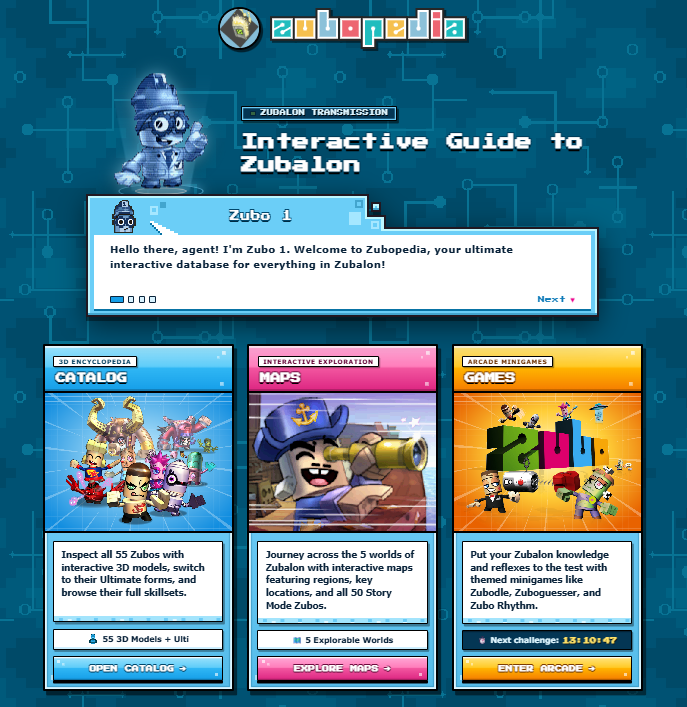
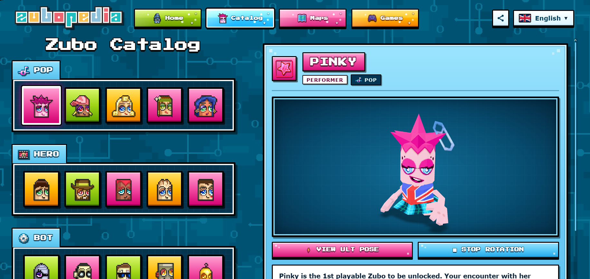
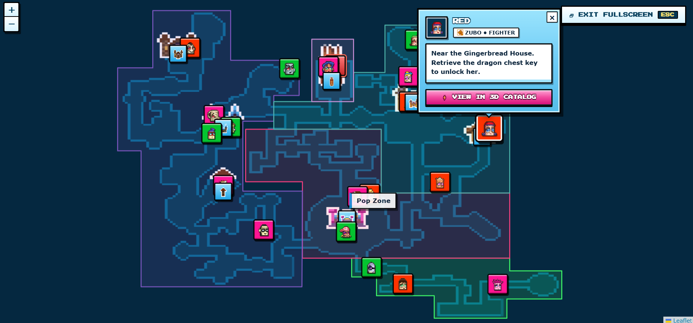
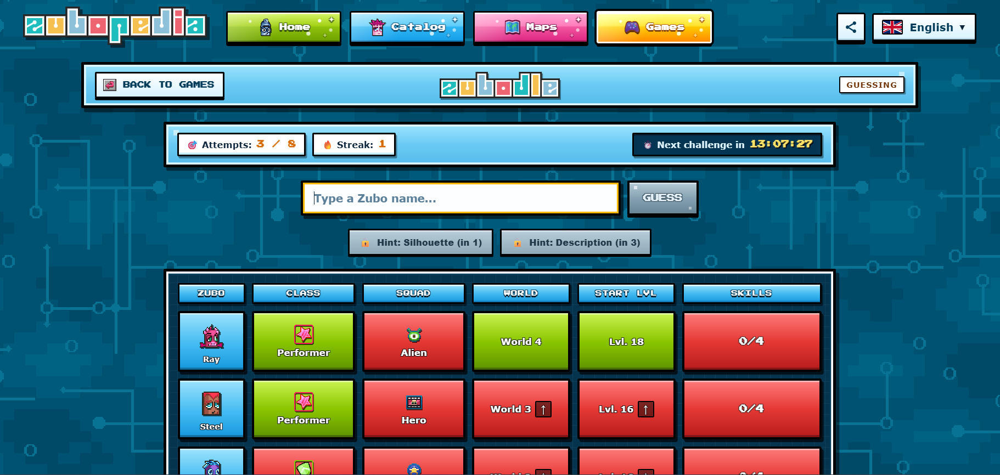

  

  <h1>Zubopedia</h1>
  

    <strong>An interactive 3D encyclopedia, world maps hub, and daily minigames website for <em>Zubo</em> (Nintendo DS, 2008).</strong>
  

  

    
    
  

  

    
    
    
    
    
    
    
  

  

    <a href="https://zubopedia.pages.dev/?lang=en">English</a> ·
    <a href="https://zubopedia.pages.dev/">Español</a> ·
    <a href="https://zubopedia.pages.dev/?lang=fr">Français</a> ·
    <a href="https://zubopedia.pages.dev/?lang=de">Deutsch</a>
  

---

## About Zubopedia

**Zubopedia** is a free, ad-free, non-profit fan project dedicated to preserving and celebrating ***Zubo***, the 2008 rhythm-RPG developed by EA Bright Light for the **Nintendo DS**.

Because reliable documentation and interactive resources for *Zubo* are scarce across the web, Zubopedia brings together all 55 playable Zubos, the 5 overworld maps of Zubalon, and themed browser minigames in a responsive web interface inspired by the game's original style.

> **Note about this repository:** This public repository serves as the official showcase, changelog, and community issue tracker for Zubopedia. The application source code and extracted 3D assets are maintained in a separate private repository.

---

## Screenshots

<table>
  <tr>
    <th width="50%">Home</th>
    <th width="50%">3D Zubo Catalog</th>
  </tr>
  <tr>
    <td width="50%" align="center"></td>
    <td width="50%" align="center"></td>
  </tr>
  <tr>
    <th width="50%">Interactive World Maps</th>
    <th width="50%">Zubodle Daily Minigame</th>
  </tr>
  <tr>
    <td width="50%" align="center"></td>
    <td width="50%" align="center"></td>
  </tr>
</table>

---

## Key Features

### 1. 3D Zubo Catalog (`/catalogo`)
- **All 55 playable Zubos** grouped across their 11 teams, with interactive rotatable **3D models** rendered in real time via WebGL (`Three.js`).
- **Ult form toggle** (currently featuring Pinky's Ult model, with more Ult forms planned).
- Starting level, team, class (*Fighter*, *Defender*, *Performer*), full 4-skill movepool, and localized descriptions.
- Direct shareable URLs for every individual Zubo (e.g. `/catalogo/Pinky?lang=en`).

### 2. Interactive World Maps (`/mapas`)
- Top-screen 2D maps for **all 5 worlds of Zubalon** built with **Leaflet** using custom coordinate space.
- Color-coded clickable regions, landmarks, bosses, and exact unlock locations for all **50 story-mode Zubos**.
- Category filters (*All*, *Zubos*, *Landmarks*, *Bosses*), fullscreen mode, and quick jump links straight from map markers into the 3D Catalog.

### 3. Games Hub & Zubodle (`/juegos`)
- **Zubodle (`/juegos/zubodle`):** A daily *Wordle / Pokedle*-style character guessing game with 8 attempts, streak tracking, hint system (world, team, class, starting level, shared skills), and spoiler-free emoji result sharing.
- Progress and streaks are stored locally in the browser (`localStorage`) — no accounts, no cookies, no tracking banners.

### 4. Multilingual & Responsive
- Fully localized in **4 languages** (**English**, **Spanish**, **French**, and **German**), including official localized Zubo names, classes, teams, and skills.
- Responsive layout tailored for both desktop and mobile viewports.

---

## Tech Stack & Engineering Highlights

- **Frontend:** React, Vite, TypeScript / JavaScript, custom UI inspired by *Zubo*'s original style & animated circuit canvas background.
- **3D Rendering:** Three.js (`GLTFLoader`, OrbitControls, custom lighting and auto-rotation).
- **Interactive Mapping:** Leaflet with custom image overlays, polygon zones, and custom sprite DivIcons.
- **Internationalization:** `i18next` with URL query sync (`?lang=es|en|fr|de`) and persistent browser preference.
- **Edge Hosting & SEO:** Cloudflare Pages + custom **Pages Functions Edge Middleware** (`HTMLRewriter`) dynamically injecting localized `<title>`, meta descriptions, `canonical`, `hreflang`, Open Graph / Twitter cards, and semantic `<noscript>` content for all 65 routes × 4 languages.
- **Privacy:** Zero personal data collected, zero cookies, cookie-free Cloudflare Web Analytics.

---

## Roadmap

- [x] Interactive 3D Catalog for all 55 playable Zubos
- [x] Interactive Leaflet maps for all 5 worlds of Zubalon
- [x] Daily **Zubodle** minigame with streaks & result sharing
- [x] Full 4-language localization (**ES / EN / FR / DE**) & multilingual Edge SEO
- [ ] Remaining Ult 3D models
- [ ] Villains / Zombos catalog section
- [ ] **Zuboguesser** minigame (locate in-game screenshots on the world maps)
- [ ] **Zubo Rhythm** minigame (browser-adapted rhythm combat)

---

## Feedback, Bugs & Suggestions

Found a bug, a missing translation, or a lore detail to improve? You can:
- Open an issue right here in [**GitHub Issues**](https://github.com/SergioCamRoig18/Zubopedia-Web/issues).
- Or reach out by email via the contact address in the footer of [zubopedia.pages.dev](https://zubopedia.pages.dev/?lang=en).

---

## Legal Notice

Zubopedia is a non-profit fan website created out of appreciation for *Zubo* (Nintendo DS). *Zubo* and all related characters, models, names, and artwork are trademarks and property of **Electronic Arts Inc.** This project is not affiliated with, endorsed by, or sponsored by Electronic Arts. No ROMs or copyrighted game files are hosted for download.
